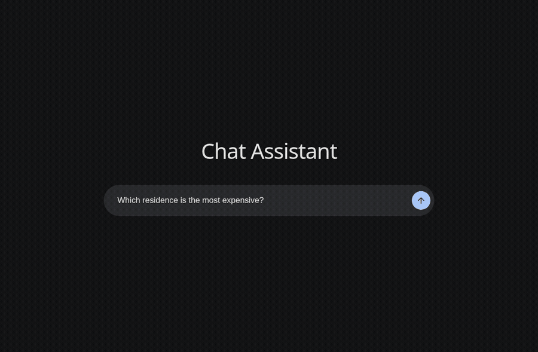
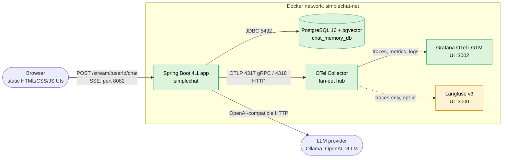
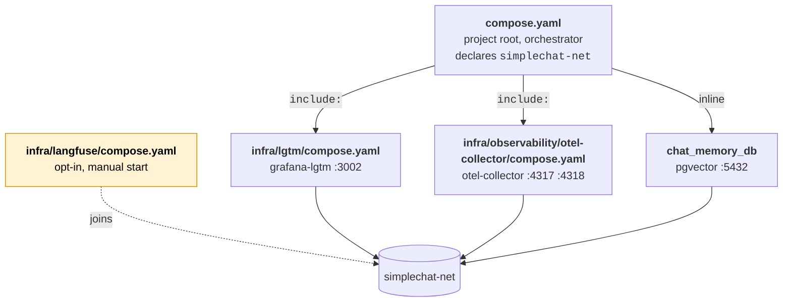
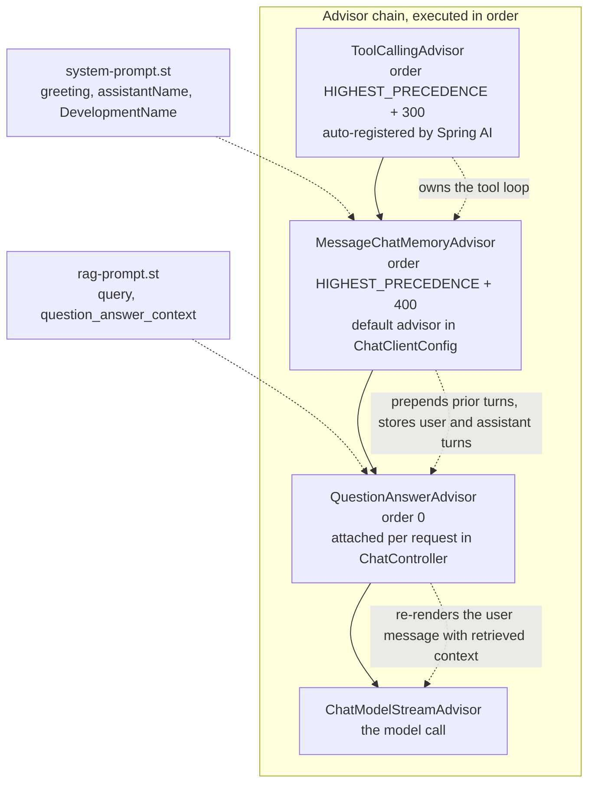
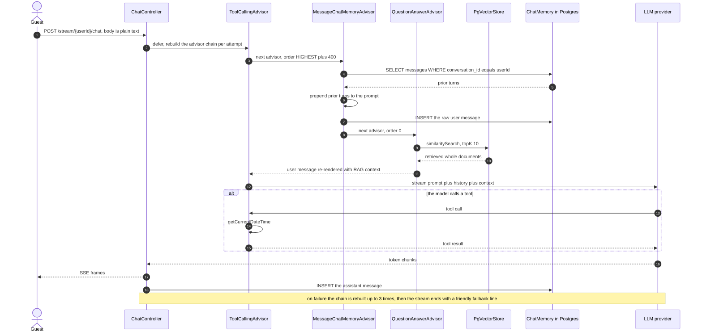
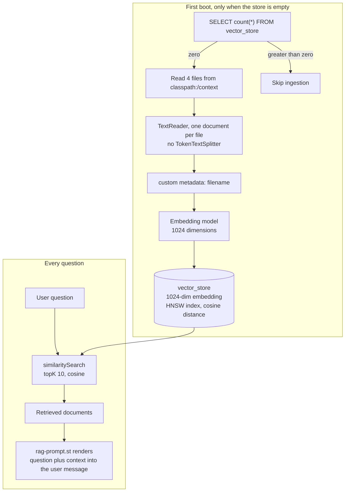
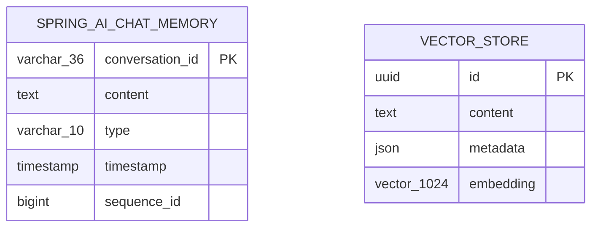
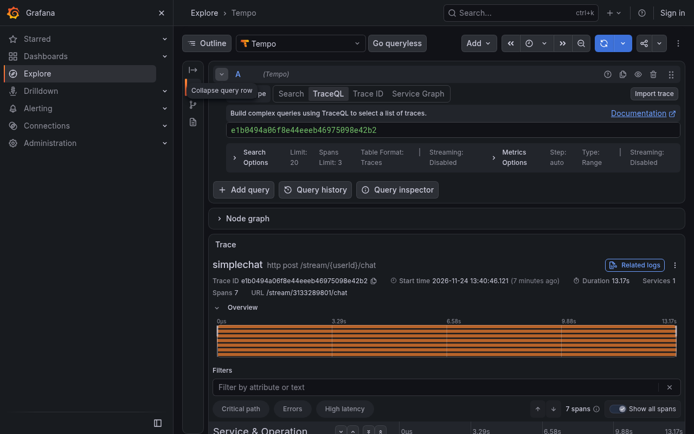

<div align="center">

# Simplechat

**A Spring AI chat backend with streaming responses, persistent memory, RAG over your own docs, and pluggable observability.**

[](https://github.com/jnolasco-portfolio/simplechat/actions/workflows/ci.yml)
[](#-quick-start)
[](#-at-a-glance)
[](#-at-a-glance)
[](https://github.com/pgvector/pgvector)
[](#-quick-start)
[](#-quick-start)
[](LICENSE)

[Demo](#-demo) ·
[Capabilities](#-capabilities) ·
[Architecture](#-architecture) ·
[Advisor chain](#-the-advisor-chain) ·
[RAG](#-rag-pipeline) ·
[Decisions](#-engineering-decisions) ·
[Quick start](#-quick-start) ·
[Observability](#-observability) ·
[API](#-api) ·
[Docs](#-documentation-map)

</div>

---

> **A Spring AI 2.1 chat backend that streams tokens over SSE, keeps per-user conversation memory in PostgreSQL, and answers questions about its own corpus with pgvector RAG.**
>
> The interesting part is not the three endpoints — it is the plumbing underneath: an advisor chain ordered so that conversation memory survives Spring AI's tool-calling loop, a vector store that ingests whole documents instead of chunks, and an OpenTelemetry collector that fans traces, metrics and logs out to Grafana with Langfuse as an opt-in second sink.
>
> Java 21 · Spring Boot 4.1 · PostgreSQL 16 + pgvector · Docker Compose · MIT — and `./mvnw test` runs with no Docker at all.

<p align="center">
  
</p>

## 🎬 Demo

The GIF above is the browser UI talking to the running backend: the request goes out as `text/plain`, the answer comes back as SSE frames, and the client renders the stream as markdown with KaTeX for math.

---

## 🧭 At a glance

|                   |                                                                                                                                            |
| ----------------- | ------------------------------------------------------------------------------------------------------------------------------------------ |
| **API**           | 3 endpoints: SSE chat stream, read history, clear history — all keyed by `userId`                                                          |
| **Memory**        | `SPRING_AI_CHAT_MEMORY` in PostgreSQL, window-based, written by `MessageChatMemoryAdvisor`                                                 |
| **RAG**           | 4 markdown fact sheets → `pgvector` `vector(1024)` + HNSW (cosine), `topK = 10`, one whole document per file                               |
| **Tools**         | 2 `@Tool` methods: current date/time in the user's timezone, time-of-day greeting                                                          |
| **Observability** | OTel traces + metrics + logs → collector fan-out → Grafana LGTM (always) → Langfuse (opt-in)                                               |
| **Frontend**      | Two dependency-free vanilla HTML/CSS/JS UIs; streamed markdown + KaTeX, client-side retry                                                  |
| **Stack**         | Java 21 · Spring Boot 4.1.0 (Web MVC, JDBC, Actuator, DevTools) · Spring AI 2.1.0 · PostgreSQL 16 + pgvector · Liquibase · Reactor · Maven |
| **Tests**         | 17 test methods across 6 classes: unit, MVC-slice and resource-contract tests on H2, no Docker                                             |
| **License**       | MIT                                                                                                                                        |

Key dependencies: `spring-ai-starter-model-openai`, `spring-ai-starter-model-chat-memory-repository-jdbc`, `spring-ai-vector-store-advisor`, `spring-ai-starter-vector-store-pgvector`.

---

> **Sample data.** The RAG corpus under `src/main/resources/context/` is **fictional**.
> *Grupo Vértice*, *Residencial Altavista* and *Punta Esmeralda Golf & Country Club*
> are invented for this demo, and every figure (unit counts, areas, prices) is synthetic.
> Nothing here describes a real company or development.

## ✨ Capabilities

| Capability                     | Where it lives                                                                                                                                                                                            |
| ------------------------------ | --------------------------------------------------------------------------------------------------------------------------------------------------------------------------------------------------------- |
| 🚀 **Streaming chat**          | [`ChatController.chat()`](src/main/java/cloud/nolasco/simplechat/ChatController.java) returns a `Flux<String>`; served as `text/event-stream` when the client asks for it, chunked `text/plain` otherwise |
| 🧠 **Per-user memory**         | `MessageChatMemoryAdvisor` over `JdbcChatMemoryRepository` (Postgres dialect) → `SPRING_AI_CHAT_MEMORY`                                                                                                   |
| 📚 **RAG over your own docs**  | `QuestionAnswerAdvisor` over the auto-configured `PgVectorStore`; corpus ingested by [`ReferenceDocsLoader`](src/main/java/cloud/nolasco/simplechat/service/ReferenceDocsLoader.java)                     |
| 🛠️ **Tool calling**            | [`CommonTools`](src/main/java/cloud/nolasco/simplechat/tools/datetime/CommonTools.java) — `@Tool` methods `getCurrentDateTime()` and `greeting()`, registered via `defaultTools(...)`                     |
| 🔌 **Pluggable observability** | OTel SDK → collector → Grafana LGTM (always) → Langfuse (opt-in); logs bridged by `OpenTelemetryAppender`                                                                                                 |
| 🐳 **Zero-config dev**         | Spring Boot auto-starts the dev graph from the root `compose.yaml` — app boots, DB is ready, collector is wired                                                                                           |
| 🧪 **No-Docker tests**         | `./mvnw test` runs the whole suite against H2 in-memory                                                                                                                                                   |
| 🖥️ **Browser UIs**             | `static/components/chat/` and `static/components/streamchat/` — vanilla HTML/CSS/JS, no build step                                                                                                        |

---

## 📐 Architecture



*Green = started automatically by `./mvnw spring-boot:run`. Yellow = opt-in. The LLM provider is whatever `BASE_URL` points at — it is never a Docker service in dev.*

### Compose topology



*The root file owns the network; the included files only pin its name (never `external: true`, because Compose's `include:` merge does not override that flag). The same layout maps 1:1 onto future Kubernetes manifests — each tool evolves independently under its own folder.*

---

## 🧠 The advisor chain

This is the part worth reading. Spring AI assembles a prompt through an ordered chain of advisors, and the order is not incidental — it decides whether your conversation history survives a tool call.



*Spring sorts advisors by `order`; the lower the value, the earlier the advisor runs.*

| Advisor                    | Where it is registered                                                                                            | Order                                    | What it does                                                                              |
| -------------------------- | ----------------------------------------------------------------------------------------------------------------- | ---------------------------------------- | ----------------------------------------------------------------------------------------- |
| `ToolCallingAdvisor`       | auto-registered by Spring AI                                                                                      | `Ordered.HIGHEST_PRECEDENCE + 300`       | Runs the tool loop. Not configured by this project.                                       |
| `MessageChatMemoryAdvisor` | [`ChatClientConfig`](src/main/java/cloud/nolasco/simplechat/config/ChatClientConfig.java), `defaultAdvisors(...)` | `ToolCallingAdvisor.DEFAULT_ORDER + 100` | Prepends prior turns to the prompt and persists the user + assistant messages.            |
| `QuestionAnswerAdvisor`    | [`ChatController`](src/main/java/cloud/nolasco/simplechat/ChatController.java), per request                       | `0`                                      | Retrieves `topK = 10` documents and re-renders the **user message** with `rag-prompt.st`. |

Both prompt templates are plain text files on the classpath, so they can be edited without touching Java: [`system-prompt.st`](src/main/resources/prompts/system-prompt.st) is rendered into the system message with `{greeting}`, `{assistantName}` and `{DevelopmentName}`, and [`rag-prompt.st`](src/main/resources/prompts/rag-prompt.st) is rendered per request with `{query}` and `{question_answer_context}`.

Two details that are easy to miss:

- **The memory order is load-bearing.** When Spring AI sees a `MemoryAdvisor` with a *higher* order than the tool-calling advisor, it disables the tool advisor's own conversation history so that memory owns history for every tool-call iteration. Setting the memory advisor to `ToolCallingAdvisor.DEFAULT_ORDER + 100` is what makes that happen — the other order silently drops injected turns on Spring AI 2.1.
- **The system prompt's greeting is computed once.** `commonTools.greeting()` is called while the `ChatClient` bean is built, so the "Good morning / afternoon / evening" token is frozen for the lifetime of the JVM.

## 🔄 Request lifecycle



The raw user message is persisted **before** the RAG advisor rewrites it, so the stored history stays clean — only the message that reaches the model carries the retrieved context.

## 📚 RAG pipeline



*Documents are embedded whole — no chunking — so a residence record is never split in half and superlative comparisons ("the cheapest available residence") stay correct. `topK = 10` is deliberately larger than the corpus of four fact sheets, so every question sees all of them. A document that fails to load is skipped and logged, never fatal.*

## 📊 Data model



*Two independent stores, linked only by the request's `userId` — there is no foreign key between them.*

- `SPRING_AI_CHAT_MEMORY` carries a `CHECK (type IN ('USER','ASSISTANT','SYSTEM','TOOL'))` constraint and an index on `(conversation_id, timestamp)`. The `sequence_id BIGINT` column was added by changeset `1.6` because Spring AI 2.0's JDBC repository requires it.
- `vector_store.embedding` is `vector(1024)`, indexed with HNSW on `vector_cosine_ops`. The changeset creates the index without a name, so Postgres derives `vector_store_embedding_idx` — the precondition checks exactly that name.
- The schema belongs to **Liquibase**, not to Hibernate: `initialize-schema: never` on both the vector store and the chat-memory repository, so Spring AI never issues DDL. Changesets live in [`db.changelog-master.yaml`](src/main/resources/db/changelog/db.changelog-master.yaml) and run in id order, each guarded by an `onFail: MARK_RAN` precondition.

---

## 🧭 Engineering decisions

| Decision                                                                                             | Why                                                                                                                                                         | Consequence                                                                                                                                 |
| ---------------------------------------------------------------------------------------------------- | ----------------------------------------------------------------------------------------------------------------------------------------------------------- | ------------------------------------------------------------------------------------------------------------------------------------------- |
| The RAG advisor is attached **per request**, not as a default advisor                                | The retrieval policy (store, `topK`, template) is a property of the call, not of the client                                                                 | One `ChatClient` bean serves both RAG and plain calls, and `ChatClientConfig` stays a wiring-only class                                     |
| Memory is ordered **after** the tool-calling advisor (`ToolCallingAdvisor.DEFAULT_ORDER + 100`)      | In Spring AI 2.1 the tool advisor disables its internal history when a memory advisor sits downstream, so memory owns history for every tool-call iteration | History survives multi-turn *and* tool-calling flows; the ordering constant is load-bearing, not cosmetic                                   |
| One **whole document** per fact sheet — no `TokenTextSplitter`                                       | The corpus is flat, self-contained records; chunking splits a residence record in half and breaks superlative comparisons                                   | Retrieval returns complete records, at the cost of a coarser embedding granularity                                                          |
| Retrieval is **fail-soft**: `count(*)` guard, per-document `safeLoad`, catch-all in `@PostConstruct` | One unreadable document or a not-yet-migrated table must not stop the application from booting                                                              | The app always starts; degraded RAG and the root-cause chain are logged instead of thrown                                                   |
| Streaming is `Flux.defer(...).retry(3)` then `onErrorResume(...)`                                    | Re-subscribing to an already-consumed flux would reuse a consumed advisor chain; `defer` rebuilds it per attempt                                            | Up to 4 attempts (1 + 3 retries), then the stream ends with a friendly fallback line instead of a broken connection                         |
| `spring-boot-docker-compose` is `runtime` + `optional=true`                                          | `optional=true` makes the Spring Boot plugin strip the module from the production fat JAR                                                                   | The prod profile wires its own `DataSource` and fails fast via `${VAR:?message}` — the dev graph cannot leak into production                |
| The OTel collector is the only fan-out point; the app never holds the Langfuse secret                | The application has no business knowing the Langfuse credential                                                                                             | With `LANGFUSE_OTEL_AUTH` unset only the Langfuse exporter logs `401/403` and LGTM keeps working — degradation is contained to one exporter |
| `opentelemetry-logback-appender-1.0` is pinned to `2.28.1-alpha`, with the reason in the POM         | `2.21.0` pulls `api-incubator 1.55.0-alpha`, which lacks methods the OTel SDK 1.62.0 calls (`NoSuchMethodError` on `SdkConfigProvider`)                     | A deliberate, commented exception to BOM resolution instead of a silent `NoSuchMethodError` at boot                                         |

---

## 🚀 Quick start

**You need** JDK 21, Maven 3.9+ (or just use the bundled `./mvnw`), Docker Engine 24+ with Compose v2.20+ (the `include:` keyword needs v2.20+), and an OpenAI-compatible endpoint — [Ollama](https://ollama.com), [LM Studio](https://lmstudio.ai), [vLLM](https://docs.vllm.ai), OpenAI, Groq.

> **Tests need no Docker at all.** `./mvnw test` uses H2 in-memory.

### 1 · Clone

```bash
git clone https://github.com/jnolasco-portfolio/simplechat.git
cd simplechat
```

### 2 · Point at an LLM

The defaults below assume [Ollama](https://ollama.com) running on the host — the `host.docker.internal` DNS name lets the app reach the host from inside Docker.

```bash
# Defaults — Ollama on the host, with two models already pulled
export BASE_URL=http://host.docker.internal:11434/v1
export OPENAI_API_KEY=sk-no-key-needed-for-ollama
export CHAT_MODEL=granite4.1:8b
export EMBEDDING_MODEL=qwen3-embedding:0.6b
```

For other providers:

| Provider             | `BASE_URL`                             | `OPENAI_API_KEY`              |
| -------------------- | -------------------------------------- | ----------------------------- |
| **Ollama** (default) | `http://host.docker.internal:11434/v1` | `sk-no-key-needed-for-ollama` |
| **LM Studio**        | `http://host.docker.internal:1234/v1`  | `sk-no-key-needed`            |
| **OpenAI**           | `https://api.openai.com/v1`            | `sk-...` (your real key)      |
| **vLLM** (local)     | `http://host.docker.internal:8000/v1`  | `sk-no-key-needed`            |

### 3 · Run it

```bash
./mvnw spring-boot:run
```

Spring Boot's `spring.docker.compose` integration reads the root `compose.yaml` and brings up the whole dev graph — `chat_memory_db`, `grafana-lgtm` and `otel-collector` — before the app starts.

| What you want                     | Command                              | What starts                                                                                     | What you give up                          |
| --------------------------------- | ------------------------------------ | ----------------------------------------------------------------------------------------------- | ----------------------------------------- |
| 🟢 **Chat + local observability** | `./mvnw spring-boot:run`             | `chat_memory_db`, `grafana-lgtm`, `otel-collector`                                              | The LLM provider is still external.       |
| 🟣 **+ LLM tracing in Langfuse**  | See [Observability](#-observability) | All of the above **plus** `langfuse-web`, `langfuse-worker`, postgres, clickhouse, minio, redis | Heavier — ~2-3 min cold start, ~2 GB RAM. |
| ⚪ **No Docker at all (tests)**   | `./mvnw test`                        | H2 in-memory                                                                                    | Nothing — pure CI / unit test path.       |

> **The app never blocks on optional services.** The collector's `langfuse` exporter is gated on the `LANGFUSE_OTEL_AUTH` env var. If it is empty (or langfuse is not running) you get a `401/403` *in the collector logs only* — the LGTM exporter keeps working and the app does not slow down.

### 4 · Hit it

```bash
# In another terminal — the app listens on 8082
curl -N -X POST http://localhost:8082/stream/visitor-001/chat \
     -H 'Content-Type: text/plain' \
     --data 'Hola, ¿qué incluye la unidad B-17?'
```

```bash
# Read a user's history
curl http://localhost:8082/visitor-001/history | jq

# Clear a user's history
curl -X DELETE http://localhost:8082/visitor-001/history
```

Then open the UI in a browser:

- http://localhost:8082/components/streamchat/streamchat.html — streaming chat with markdown + KaTeX rendering
- http://localhost:8082/components/chat/chat.html — non-streaming chat

---

## 🔧 Configuration

All knobs live in [src/main/resources/application.yaml](src/main/resources/application.yaml) and can be overridden with environment variables. The app also reads an optional `.env` file from the working directory (`spring.config.import=optional:file:./.env[.properties]`).

| Variable                 | Default                                | Required? | Description                                                                                     |
| ------------------------ | -------------------------------------- | --------- | ----------------------------------------------------------------------------------------------- |
| `BASE_URL`               | `http://host.docker.internal:11434/v1` | ✅        | OpenAI-compatible endpoint                                                                      |
| `OPENAI_API_KEY`         | `sk-...`                               | ✅        | API key (most local servers ignore it)                                                          |
| `CHAT_MODEL`             | `granite4.1:8b`                        | ✅        | Chat model id (must be available at `BASE_URL`)                                                 |
| `EMBEDDING_MODEL`        | `qwen3-embedding:0.6b`                 | ✅        | Embedding model. **Dimension must equal 1024** to match the `vector(1024)` column in Liquibase. |
| `LANGFUSE_OTEL_AUTH`     | _(unset)_                              | ⚪        | `Basic <base64(pk:sk)>` — see below. Empty means langfuse export is disabled.                   |
| `DB_HOST`                | `localhost`                            | 🟡 prod   | PostgreSQL host (prod profile only)                                                             |
| `DB_PORT`                | `5432`                                 | 🟡 prod   | PostgreSQL port                                                                                 |
| `POSTGRES_DB`            | _(unset)_                              | 🟡 prod   | PostgreSQL database name (required in prod)                                                     |
| `DB_USERNAME`            | `postgres`                             | 🟡 prod   | Database user                                                                                   |
| `DB_PASSWORD`            | `postgres`                             | 🟡 prod   | Database password                                                                               |
| `SPRING_PROFILES_ACTIVE` | _(unset = dev)_                        | 🟡 prod   | Set to `prod` for production.                                                                   |

> ⚠️ **In dev, `DB_*` values in `.env` are unused.** Spring Boot's `spring.docker.compose` auto-wires the DataSource from the running `chat_memory_db` container via the `org.springframework.boot.service-connection=postgres` label. Supply `DB_*` and `POSTGRES_DB` only for the `prod` profile.
>
> ⚠️ **In prod, you must set `SPRING_PROFILES_ACTIVE=prod`, the `DB_*` vars, and `POSTGRES_DB`.** The prod profile uses `${VAR:?message}` syntax and fails fast at startup with a clear error if any required var is missing.

---

## 🔌 API

| Method   | Path                    | Body                    | Response                                | Notes                                                                                                                                                                                                                                                   |
| -------- | ----------------------- | ----------------------- | --------------------------------------- | ------------------------------------------------------------------------------------------------------------------------------------------------------------------------------------------------------------------------------------------------------- |
| `POST`   | `/stream/{userId}/chat` | raw prompt (text/plain) | `text/event-stream` from `Flux<String>` | Streams tokens as they're produced. Send `Accept: text/event-stream` for SSE framing; otherwise the same endpoint streams chunked `text/plain`. Errors after 3 retries return the fallback `"Sorry, the connection was interrupted. Please try again."` |
| `GET`    | `/{userId}/history`     | —                       | `List<Message>` (JSON)                  | Returns up to `MessageWindowChatMemory`'s window of prior messages.                                                                                                                                                                                     |
| `DELETE` | `/{userId}/history`     | —                       | `String` (text)                         | Clears the user's conversation history.                                                                                                                                                                                                                 |

The `userId` is the conversation key — all memory (and the RAG-augmented context) is scoped per userId. The controller is annotated `@CrossOrigin` without an origin list, so any origin may call it; that is intentional for a demo and worth restricting before production.

---

## 🧪 Testing

```bash
# Unit + slice tests — no Docker required
./mvnw test

# Quick compile
./mvnw -DskipTests package
```

Tests run under the **`test`** profile: H2 in-memory (PostgreSQL mode), Liquibase **disabled** (the prod changelog uses `CREATE EXTENSION vector` and `vector(...)` syntax H2 cannot execute), and the `ChatClient`, `ChatMemory`, `VectorStore` and `IngestService` mocked.

| Test class                   | What it guards                                                                                                                    |
| ---------------------------- | --------------------------------------------------------------------------------------------------------------------------------- |
| `SimplechatApplicationTests` | The context boots under the `test` profile with the AI beans mocked.                                                              |
| `ChatControllerTest`         | Streaming, RAG context, conversation id, the retry count, the fallback, and the history endpoints.                                |
| `ChatControllerWebTest`      | MVC slice: real `text/event-stream` framing via `MockMvc` + `asyncDispatch`.                                                      |
| `ReferenceDocsLoaderTest`    | One whole document per file, skip when the store is non-empty, survive a failing document, stay quiet when the count query fails. |
| `ReferenceContextFormatTest` | Record fields, counts and the verified superlatives in the corpus.                                                                |
| `PromptResourcesTest`        | Both prompt templates keep their placeholders.                                                                                    |

> A `H2 ... "VECTOR" not found` warning in the test log is expected and harmless — the prod schema is managed by Liquibase, not by Hibernate auto-DDL.

See [`.github/instructions/testing.instructions.md`](.github/instructions/testing.instructions.md) for the full contract an agent must respect when adding tests.

---

## 📡 Observability

The OTel collector is the fan-out hub: the app's OTLP endpoints never changed, and adding a second sink is one exporter in the collector config, not a code change.

- **traces** → `grafana-lgtm:4318` **and** `langfuse-web:3000/api/public/otel/v1/traces` (the Langfuse exporter carries an `Authorization: Basic …` header, and only when `LANGFUSE_OTEL_AUTH` is set)
- **metrics** → `grafana-lgtm:4318` only
- **logs** → `grafana-lgtm:4318` only (Langfuse ingests neither)

The pipeline itself is a single `batch` processor (5 s timeout) feeding two `otlphttp` exporters — see [`otel-collector-config.yaml`](infra/observability/otel-collector/otel-collector-config.yaml).

### Grafana LGTM (auto-started)

| UI                                            | URL                   | Notes                                                          |
| --------------------------------------------- | --------------------- | -------------------------------------------------------------- |
| Grafana (Explore → Tempo / Prometheus / Loki) | http://localhost:3002 | ⚠️ **Port 3002, not 3000** — 3000 is reserved for langfuse-web. |
| OTLP HTTP receiver                            | `localhost:4318`      | Where the Spring app sends traces/metrics/logs.                |
| OTLP gRPC receiver                            | `localhost:4317`      | Same, gRPC flavour.                                            |

<p align="center">
  
</p>

*One `POST /stream/{userId}/chat` request in Tempo: 7 spans, 13.17 s wall clock on a local 8B model. Not a benchmark — just what one run looks like.*

<details>
<summary><strong>Langfuse v3 (opt-in)</strong> — heavy stack, manual start</summary>

Langfuse adds purpose-built LLM tracing (per-prompt, per-completion, scores, datasets). It is heavy (postgres + clickhouse + redis + minio + web + worker), so it is a manual start.

There are **two distinct sets of credentials** to keep straight:

| Set                                                                                                                                              | Lives in                                                      | Purpose                                                        |
| ------------------------------------------------------------------------------------------------------------------------------------------------ | ------------------------------------------------------------- | -------------------------------------------------------------- |
| **Stack secrets** — `SALT`, `ENCRYPTION_KEY`, `NEXTAUTH_SECRET`, `POSTGRES_PASSWORD`, `CLICKHOUSE_PASSWORD`, `MINIO_ROOT_PASSWORD`, `REDIS_AUTH` | `infra/langfuse/.env` (consumed by the langfuse compose file) | Boots the langfuse services themselves                         |
| **Web UI login** — `LANGFUSE_INIT_USER_EMAIL` / `_PASSWORD` (optional)                                                                           | `infra/langfuse/.env`                                         | Seeds the first user so you can log in                         |
| **Project API keys** — `LANGFUSE_PUBLIC_KEY` / `LANGFUSE_SECRET_KEY` (created in the UI)                                                         | UI → project → Settings → API Keys                            | Auth header for the OTel collector                             |
| `LANGFUSE_OTEL_AUTH`                                                                                                                             | Project-root `.env` (or shell)                                | `Basic <base64(pk:sk)>` header the collector sends to langfuse |

```bash
# 1. Stack secrets — copy the example, fill in the CHANGEME values
cp infra/langfuse/.env.example infra/langfuse/.env
$EDITOR infra/langfuse/.env

# 2. Start the stack (~2-3 min on a warm host)
docker compose -f infra/langfuse/compose.yaml \
               --env-file infra/langfuse/.env up -d

# 3. Watch the web container come up
docker logs -f langfuse-langfuse-web-1   # wait for "Ready"
```

#### Web UI login

There are **no default credentials** — langfuse refuses to ship a default admin. Pick one of:

- **Interactive first-run (default).** Open http://localhost:3000 and the landing page will show a **Sign up** form (not Sign in). Pick any name, email, and password (≥ 8 chars) — nothing is sent anywhere, this is a local self-hosted instance. The first user becomes the org owner.
- **Seed an admin at boot.** Add these to `infra/langfuse/.env` **before** step 2 and the langfuse container provisions an org, project, and admin user on first start — no interactive form:

  ````bash
  LANGFUSE_INIT_ORG_ID=org-1
  LANGFUSE_INIT_ORG_NAME=simplechat
  LANGFUSE_INIT_PROJECT_ID=proj-1
  LANGFUSE_INIT_PROJECT_NAME=simplechat
  LANGFUSE_INIT_USER_EMAIL=admin@local
  LANGFUSE_INIT_USER_NAME=Admin
  LANGFUSE_INIT_USER_PASSWORD='changeme123!'
  ````

  Then log in at `/auth/sign-in` with those credentials. The seeded project's public/secret keys are also printed in the `langfuse-web` container logs.

#### Wire the OTel collector to langfuse

The collector needs an `Authorization: Basic <base64(pk:sk)>` header on every trace export. Two options:

**A. Put it in the project-root `.env` (simplest — picked up by `docker compose` automatically):**

````bash
# Project root: .env
LANGFUSE_PUBLIC_KEY=pk-lf-...
LANGFUSE_SECRET_KEY=sk-lf-...
# Literal value — Compose .env files do NOT support $(...) substitution.
# To regenerate:  printf '%s:%s' "$PK" "$SK" | base64 -w0
LANGFUSE_OTEL_AUTH="Basic cGstbGYtLi4uOg=="
````

**B. Export in the shell, then restart the collector:**

````bash
export LANGFUSE_PUBLIC_KEY=pk-lf-...
export LANGFUSE_SECRET_KEY=sk-lf-...
export LANGFUSE_OTEL_AUTH="Basic $(printf '%s:%s' "$LANGFUSE_PUBLIC_KEY" "$LANGFUSE_SECRET_KEY" | base64 -w0)"
docker compose up -d --force-recreate --no-deps otel-collector
````

> ⚠️ Use `up -d --force-recreate --no-deps otel-collector` (not `docker compose restart`) whenever you change `LANGFUSE_OTEL_AUTH`. Compose only re-reads `.env` when it **creates** containers; `restart` keeps the existing container (and its stale env). Same applies to the langfuse stack if you change its `.env`.

> The collector keeps forwarding to LGTM even if langfuse is down. The langfuse exporter just logs `401/403` and the rest of the pipeline is unaffected. Verify success with `docker compose logs -f otel-collector | grep -i langfuse` — no `Unauthenticated` lines means traces are reaching langfuse.

</details>

---

## 🐳 Infrastructure

| File                                                                                                 | Consumer                                                             | Services                                                                             | Started when                            |
| ---------------------------------------------------------------------------------------------------- | -------------------------------------------------------------------- | ------------------------------------------------------------------------------------ | --------------------------------------- |
| [`compose.yaml`](compose.yaml) (project root)                                                        | Spring Boot `spring.docker.compose`; manual `docker compose up`      | `chat_memory_db` (pgvector)                                                          | `./mvnw spring-boot:run`                |
| [`.devcontainer/compose.yaml`](.devcontainer/compose.yaml)                                           | [`.devcontainer/devcontainer.json`](.devcontainer/devcontainer.json) | `service` (the dev container itself)                                                 | Dev container start                     |
| [`infra/lgtm/compose.yaml`](infra/lgtm/compose.yaml)                                                 | `include:`d by the root                                              | `grafana-lgtm` (UI on host port 3002)                                                | `./mvnw spring-boot:run` (via the root) |
| [`infra/observability/otel-collector/compose.yaml`](infra/observability/otel-collector/compose.yaml) | `include:`d by the root                                              | `otel-collector` (OTLP gRPC:4317, HTTP:4318)                                         | `./mvnw spring-boot:run` (via the root) |
| [`infra/langfuse/compose.yaml`](infra/langfuse/compose.yaml)                                         | Standalone (opt-in)                                                  | `langfuse-web` (UI on 3000), `langfuse-worker`, plus Postgres/ClickHouse/Redis/MinIO | Manual                                  |

### Port allocation

| Service                      | Host port                           | Note                         |
| ---------------------------- | ----------------------------------- | ---------------------------- |
| `simplechat` (the app)       | `8082`                              |                              |
| `chat_memory_db`             | `5432`                              | pgvector                     |
| `grafana-lgtm`               | `3002`                              | frees 3000 from grafana-lgtm |
| `otel-collector`             | `4317` / `4318`                     | OTLP gRPC / HTTP             |
| `langfuse-web` (UI)          | `3000`                              | frees 3000 from grafana-lgtm |
| `langfuse-worker`            | `127.0.0.1:3030`                    | loopback only                |
| langfuse `postgres`          | `127.0.0.1:5433`                    | `chat_memory_db` owns 5432   |
| langfuse `redis`             | `127.0.0.1:6379`                    | loopback only                |
| `clickhouse` (HTTP / native) | `127.0.0.1:8123` / `127.0.0.1:9000` |                              |
| `minio` (S3 / console)       | `9090` / `127.0.0.1:9091`           |                              |

---

## 📁 Project structure

```
simplechat/
├── compose.yaml                     # ← orchestrator; declares simplechat-net; includes infra/*
├── pom.xml
├── AGENTS.md                        # ← deep customization guide (start here for agents)
├── LICENSE
├── infra/
│   ├── lgtm/compose.yaml            # Grafana OTel LGTM (port 3002)
│   ├── observability/
│   │   └── otel-collector/
│   │       ├── compose.yaml
│   │       └── otel-collector-config.yaml   # fan-out pipelines
│   └── langfuse/
│       ├── compose.yaml             # opt-in Langfuse v3 stack
│       └── .env.example             # template with CHANGEME markers
├── .devcontainer/
│   ├── compose.yaml                 # dev container (shares simplechat-net)
│   └── devcontainer.json
├── docs/assets/                     # demo-chat.gif, grafana-traces.png
└── src/
    ├── main/
    │   ├── java/cloud/nolasco/simplechat/
    │   │   ├── ChatController.java
    │   │   ├── config/
    │   │   │   ├── ChatClientConfig.java
    │   │   │   └── InstallOpenTelemetryAppender.java
    │   │   ├── service/
    │   │   │   ├── ReferenceDocsLoader.java
    │   │   │   └── IngestService.java          # ← placeholder, no logic yet
    │   │   └── tools/datetime/CommonTools.java
    │   └── resources/
    │       ├── application.yaml            # default (dev) profile
    │       ├── application-prod.yaml       # prod profile (DB_* required)
    │       ├── logback-spring.xml          # console + OTel appender
    │       ├── prompts/rag-prompt.st
    │       ├── prompts/system-prompt.st
    │       ├── context/*.md                # RAG source docs
    │       ├── db/changelog/               # Liquibase
    │       └── static/components/          # streamchat.html / chat.html UIs
    └── test/
        ├── java/cloud/nolasco/simplechat/
        │   ├── ChatControllerTest.java
        │   ├── ChatControllerWebTest.java
        │   ├── SimplechatApplicationTests.java
        │   ├── context/ReferenceContextFormatTest.java
        │   ├── prompts/PromptResourcesTest.java
        │   └── service/ReferenceDocsLoaderTest.java
        └── resources/application-test.yaml  # H2 in-memory
```

---

## 🚢 Deployment

```bash
# Build the fat jar
./mvnw -DskipTests clean package
# → target/simplechat-0.0.1-SNAPSHOT.jar

# Run as a plain JVM app
SPRING_PROFILES_ACTIVE=prod \
DB_HOST=... POSTGRES_DB=... DB_USERNAME=... DB_PASSWORD=... \
java -jar target/simplechat-0.0.1-SNAPSHOT.jar
```

The prod profile:

- disables Spring Boot's Docker Compose integration (`compose is excluded from the fat JAR`)
- reads `DB_HOST`, `POSTGRES_DB`, `DB_USERNAME`, and `DB_PASSWORD` from the environment; `DB_PORT` defaults to `5432`. Required variables fail fast with `${VAR:?message}`.
- runs Liquibase migrations on startup
- points at whatever PostgreSQL + pgvector you provision

The OTel URLs in `application.yaml` are the same as in dev — point them at any OTLP endpoint (Tempo, Honeycomb, Datadog, your own collector).

---

<details>
<summary><strong>🐛 Troubleshooting — 12 known issues</strong></summary>

| Symptom                                                                                                                              | Likely cause                                                                                                                                                                                                                                                                                                                            | Fix                                                                                                                                                                                                                                                                                     |
| ------------------------------------------------------------------------------------------------------------------------------------ | --------------------------------------------------------------------------------------------------------------------------------------------------------------------------------------------------------------------------------------------------------------------------------------------------------------------------------------- | --------------------------------------------------------------------------------------------------------------------------------------------------------------------------------------------------------------------------------------------------------------------------------------- |
| `./mvnw spring-boot:run` hangs on `Starting chat_memory_db`                                                                          | The DB container is already up from a prior session.                                                                                                                                                                                                                                                                                    | `docker compose down` (or `docker rm -f chat_memory_db` if it's an orphan).                                                                                                                                                                                                             |
| `Conflict. The container name "/chat_memory_db" is already in use`                                                                   | Same as above.                                                                                                                                                                                                                                                                                                                          | `docker rm -f chat_memory_db`                                                                                                                                                                                                                                                           |
| Grafana UI not at port 3000                                                                                                          | The LGTM container moved to **3002** to make room for langfuse-web.                                                                                                                                                                                                                                                                     | http://localhost:3002                                                                                                                                                                                                                                                                   |
| `401/403` errors in `otel-collector` logs                                                                                            | The langfuse exporter is trying to send without `LANGFUSE_OTEL_AUTH`.                                                                                                                                                                                                                                                                   | Either set the env var (see above) or ignore — LGTM keeps working.                                                                                                                                                                                                                      |
| Traces appear in LGTM but not Langfuse                                                                                               | `LANGFUSE_OTEL_AUTH` is empty / wrong.                                                                                                                                                                                                                                                                                                  | Re-export it and `docker compose up -d --force-recreate --no-deps otel-collector`.                                                                                                                                                                                                      |
| Vector store search returns nothing                                                                                                  | The RAG loader ran before the table existed, or the embedding dimension changed.                                                                                                                                                                                                                                                        | The `vector_store` table is created by Liquibase. Check `vector(1024)` matches your `EMBEDDING_MODEL`.                                                                                                                                                                                  |
| Tests fail with `Schema-validation: missing column [vector]`                                                                         | H2 doesn't know about `pgvector` — that's expected.                                                                                                                                                                                                                                                                                     | The test profile disables Liquibase and mocks the vector store. The startup `H2 ... "VECTOR" not found` warning is harmless.                                                                                                                                                            |
| Spring app can't reach the LLM at `http://host.docker.internal:...`                                                                  | You're on Linux without the `host.docker.internal` DNS shim, or your LLM isn't running.                                                                                                                                                                                                                                                 | Either install the shim, change `BASE_URL` to the host's LAN IP, or run the LLM in Docker.                                                                                                                                                                                              |
| `docker compose: command not found`                                                                                                  | Compose v1 (`docker-compose`) is installed but not v2.                                                                                                                                                                                                                                                                                  | Install Compose v2 (`docker compose`, with a space) — required for `include:`.                                                                                                                                                                                                          |
| `network simplechat-net declared as external, but could not be found` during `./mvnw spring-boot:run`                                | An included compose file (`infra/lgtm/compose.yaml` or `infra/observability/otel-collector/compose.yaml`) has `networks.simplechat-net.external: true`. Compose's `include:` merge does **not** override the child's `external: true`, so the merged project thinks the network is externally managed and looks for a pre-existing one. | Remove `external: true` from both included files; keep `name: simplechat-net`. The root file owns the network, the children just join it by the pinned name.                                                                                                                            |
| `langfuse-web` log shows `Error: P1000: Authentication failed against database server` on first start                                | `POSTGRES_PASSWORD` in your `infra/langfuse/.env` doesn't match the password embedded in `DATABASE_URL` (the URL is hardcoded `postgres:postgres@…` in `infra/langfuse/compose.yaml`).                                                                                                                                                  | Either set `POSTGRES_PASSWORD=postgres` (the default in `.env.example` — keep them in sync) **or** set both `POSTGRES_PASSWORD` and `DATABASE_URL` to the same custom value. Then `docker compose -f infra/langfuse/compose.yaml down -v && up -d`.                                     |
| `curl http://localhost:3000` from the host returns `Connection refused` even though `langfuse-web` is `Up` and its logs show `Ready` | `langfuse-web` is on two networks (`langfuse-internal` and `simplechat-net`); docker-proxy may forward host:3000 to the IP on `langfuse-internal`, but Next.js binds to the IP on `simplechat-net` (the one Docker's DNS resolves the container id to).                                                                                 | The compose file already pins `hostname: 0.0.0.0` on the service so Next.js listens on all interfaces. If you customize the compose, keep that. To debug: `docker exec langfuse-langfuse-web-1 wget -qO- http://172.23.0.5:3000/api/public/health` should return `{"status":"OK",...}`. |

</details>

---

## 🧭 Documentation map

| File                                                                                                                             | What lives there                                                                                                                                 |
| -------------------------------------------------------------------------------------------------------------------------------- | ------------------------------------------------------------------------------------------------------------------------------------------------ |
| [`AGENTS.md`](AGENTS.md)                                                                                                         | Deep customization guide: build & run, compose layout, profiles, key components, env vars, RAG, testing, database schema, conventions, pitfalls. |
| [`.github/instructions/spring-ai.instructions.md`](.github/instructions/spring-ai.instructions.md)                               | Contract for agents editing Spring AI wiring (advisors, tools, system prompt, vector store).                                                     |
| [`.github/instructions/testing.instructions.md`](.github/instructions/testing.instructions.md)                                   | Contract for agents writing tests (H2 profile, Liquibase off, bean mocking).                                                                     |
| [`.github/prompts/run-app.prompt.md`](.github/prompts/run-app.prompt.md)                                                         | One-shot prompt to start the dev server.                                                                                                         |
| [`.github/prompts/add-rag-doc.prompt.md`](.github/prompts/add-rag-doc.prompt.md)                                                 | One-shot prompt to wire a new markdown doc into RAG.                                                                                             |
| [`.github/agents/upgrade-spring-ai.agent.md`](.github/agents/upgrade-spring-ai.agent.md)                                         | Focused subagent for bumping Spring AI versions.                                                                                                 |
| [`infra/observability/otel-collector/otel-collector-config.yaml`](infra/observability/otel-collector/otel-collector-config.yaml) | The OTel pipeline definition (receivers → processors → exporters).                                                                               |
| [`infra/langfuse/.env.example`](infra/langfuse/.env.example)                                                                     | Template for all Langfuse secrets.                                                                                                               |

---

## 🤝 Contributing

1. Branch from `main` (`git checkout -b your-name/short-description`).
2. Honour the contracts in `.github/instructions/`.
3. Keep the test profile green: `./mvnw test` must pass without Docker.
4. Validate any compose changes: `docker compose config --quiet` (run it from the repo root).
5. Open a PR with a clear before/after and a link to the relevant context doc.

---

## 📄 License

MIT — see [`LICENSE`](LICENSE).

<div align="center">

<sub>Built with Spring AI · Powered by pgvector · Observed by OpenTelemetry</sub>

</div>
