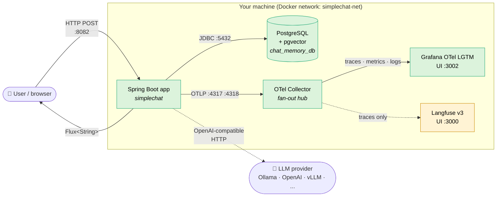
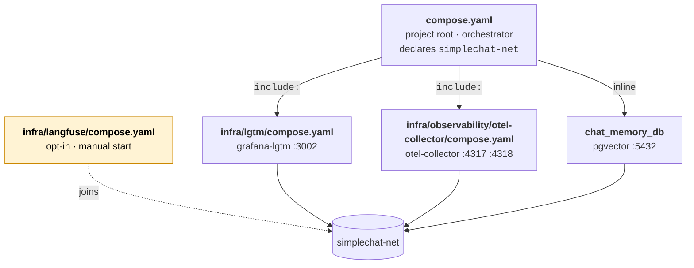
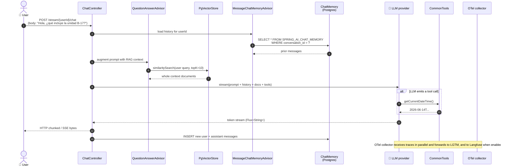
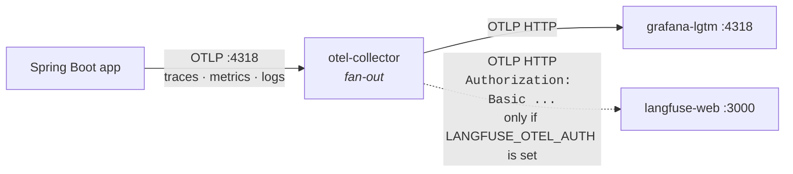

<div align="center">

# Simplechat

**A Spring AI chat backend with streaming responses, persistent memory, RAG over your own docs, and pluggable observability.**

[](https://github.com/jnolasco-portfolio/simplechat/actions/workflows/ci.yml)
[](#-prerequisites)
[](#-tech-stack)
[](#-tech-stack)
[](https://github.com/pgvector/pgvector)
[](#-prerequisites)
[](#-prerequisites)

[Features](#-features) ·
[Architecture](#-architecture) ·
[Interaction](#-interaction) ·
[Quick start](#-quick-start) ·
[Optional stack](#-optional-observability-stack) ·
[API](#-api) ·
[Docs](#-documentation-map)

</div>

---

> **Sample data.** The RAG corpus under `src/main/resources/context/` is **fictional**.
> *Grupo Vértice*, *Residencial Altavista* and *Punta Esmeralda Golf & Country Club*
> are invented for this demo, and every figure (unit counts, areas, prices) is synthetic.
> Nothing here describes a real company or development.

## ✨ Features

|                                |                                                                                                                             |
| ------------------------------ | --------------------------------------------------------------------------------------------------------------------------- |
| 🚀 **Streaming chat**          | `POST /stream/{userId}/chat` returns `Flux<String>` — pipe it straight into an SSE handler.                                 |
| 🧠 **Per-user memory**         | `MessageChatMemoryAdvisor` + `JdbcChatMemoryRepository` → PostgreSQL.                                                       |
| 📚 **RAG over your docs**      | `QuestionAnswerAdvisor` + `pgvector` (HNSW). Markdown in `src/main/resources/context/` loads as whole documents on first startup. |
| 🛠️ **Tool calling**            | `CommonTools.getCurrentDateTime()` registered via `defaultTools(...)`.                                                     |
| 🔌 **Pluggable observability** | OTel traces/metrics/logs go to a fan-out collector → Grafana LGTM (always on) → Langfuse (opt-in).                          |
| 🧪 **H2 test profile**         | `./mvnw test` runs with no Docker at all.                                                                                   |
| 🐳 **Zero-config dev**         | Spring Boot auto-starts the dev graph from the root `compose.yaml`; the app boots, the DB is ready, the collector is wired. |

---

## 🏛️ Architecture



The **required** services (green) are auto-started by Spring Boot on `./mvnw spring-boot:run`. The **optional** Langfuse stack is started manually (yellow). The LLM provider is whatever you point `BASE_URL` at.

### Compose topology



Same layout maps 1:1 onto future Kubernetes manifests — each tool evolves independently under its own folder.

---

## 🔄 Interaction

What happens when the user sends a message:



Key behaviours baked into [`ChatController`](src/main/java/cloud/nolasco/simplechat/ChatController.java) and [`ChatClientConfig`](src/main/java/cloud/nolasco/simplechat/config/ChatClientConfig.java):

- **Retry** — `Flux.defer(...).retry(3)` rebuilds the advisor chain on each attempt so a transient LLM hiccup doesn't drop the connection.
- **Graceful degradation** — `.onErrorResume(...)` returns a friendly Spanish fallback on terminal failure.
- **System prompt** — loaded from `classpath:/prompts/system-prompt.st` with `{greeting}`, `{assistantName}`, `{DevelopmentName}` placeholders.

---

## 📋 Prerequisites

| Tool              | Version                            | Why                                                                                                                                                    |
| ----------------- | ---------------------------------- | ------------------------------------------------------------------------------------------------------------------------------------------------------ |
| **JDK**           | 21+                                | Project compiles with `<java.version>21</java.version>`                                                                                                |
| **Maven**         | 3.9+ (or use the bundled `./mvnw`) | Build & test                                                                                                                                           |
| **Docker Engine** | 24+ with Compose v2.20+            | Auto-starts the dev graph (Postgres, LGTM, OTel collector). The `include:` keyword needs v2.20+.                                                       |
| **LLM endpoint**  | OpenAI-compatible                  | Anything reachable from your machine: [Ollama](https://ollama.com), [LM Studio](https://lmstudio.ai), [vLLM](https://docs.vllm.ai), OpenAI, Groq, etc. |

> **No Docker for tests.** `./mvnw test` uses H2 in-memory and does not touch Docker.

---

## 🚀 Quick start

### 1 · Clone

```bash
git clone https://github.com/jnolasco-portfolio/simplechat.git
cd simplechat
```

### 2 · Point at an LLM

Pick whichever fits your machine. The defaults below assume [Ollama](https://ollama.com) running on the host (the `host.docker.internal` DNS name lets the app reach the host from inside Docker).

```bash
# Defaults — Ollama on the host, with two models already pulled
export BASE_URL=http://host.docker.internal:11434/v1
export OPENAI_API_KEY=sk-no-key-needed-for-ollama
export CHAT_MODEL=granite4.1:8b
export EMBEDDING_MODEL=qwen3-embedding:0.6b
```

For other providers:

| Provider             | `BASE_URL`                             | `OPENAI_API_KEY`              |
| -------------------- | -------------------------------------- | ----------------------------- |
| **Ollama** (default) | `http://host.docker.internal:11434/v1` | `sk-no-key-needed-for-ollama` |
| **LM Studio**        | `http://host.docker.internal:1234/v1`  | `sk-no-key-needed`            |
| **OpenAI**           | `https://api.openai.com/v1`            | `sk-...` (your real key)      |
| **vLLM** (local)     | `http://host.docker.internal:8000/v1`  | `sk-no-key-needed`            |

### 3 · Pick your observability level

The dev graph is **modular** — core services start automatically; Langfuse is opt-in. The table below shows what `./mvnw spring-boot:run` starts and what each layer costs.

| What you want                                        | Command                                                            | What starts                                                                                     | What you give up                                              |
| ---------------------------------------------------- | ------------------------------------------------------------------ | ----------------------------------------------------------------------------------------------- | ------------------------------------------------------------- |
| 🟢 **Chat + local observability**                    | `./mvnw spring-boot:run`                                           | `chat_memory_db`, `grafana-lgtm`, `otel-collector`                                              | LLM provider is still external.                               |
| 🟣 **+ LLM tracing in Langfuse**                     | See [Optional observability stack](#-optional-observability-stack) | All of the above **plus** `langfuse-web`, `langfuse-worker`, postgres, clickhouse, minio, redis | Heavier — ~2-3 min cold start, ~2 GB RAM.                     |
| ⚪ **No Docker at all (tests)**                      | `./mvnw test`                                                      | H2 in-memory                                                                                    | Nothing — pure CI / unit test path.                           |

> **The app never blocks on optional services.** The OTel collector's `langfuse` exporter is gated on the `LANGFUSE_OTEL_AUTH` env var. If it's empty (or langfuse isn't running) you get a `401/403` _in the collector logs only_ — the LGTM exporter keeps working and the app doesn't slow down.

### 4 · Hit it

```bash
# In another terminal — the app listens on 8082
curl -N -X POST http://localhost:8082/stream/visitor-001/chat \
     -H 'Content-Type: text/plain' \
     --data 'Hola, ¿qué incluye la unidad B-17?'
```

```bash
# Read a user's history
curl http://localhost:8082/visitor-001/history | jq

# Clear a user's history
curl -X DELETE http://localhost:8082/visitor-001/history
```

Then open the UI in a browser:

- http://localhost:8082/components/streamchat/streamchat.html — streaming chat with markdown + KaTeX rendering
- http://localhost:8082/components/chat/chat.html — non-streaming chat

---

## ⚙️ Configuration

All knobs live in [src/main/resources/application.yaml](src/main/resources/application.yaml) and can be overridden with environment variables. The app also reads an optional `.env` file from the working directory (`spring.config.import=optional:file:./.env[.properties]`).

| Variable                 | Default                                | Required? | Description                                                                                     |
| ------------------------ | -------------------------------------- | --------- | ----------------------------------------------------------------------------------------------- |
| `BASE_URL`               | `http://host.docker.internal:11434/v1` | ✅        | OpenAI-compatible endpoint                                                                      |
| `OPENAI_API_KEY`         | `sk-...`                               | ✅        | API key (most local servers ignore it)                                                          |
| `CHAT_MODEL`             | `granite4.1:8b`                        | ✅        | Chat model id (must be available at `BASE_URL`)                                                 |
| `EMBEDDING_MODEL`        | `qwen3-embedding:0.6b`                 | ✅        | Embedding model. **Dimension must equal 1024** to match the `vector(1024)` column in Liquibase. |
| `LANGFUSE_OTEL_AUTH`     | _(unset)_                              | ⚪        | `Basic <base64(pk:sk)>` — see below. Empty means langfuse export is disabled.                   |
| `DB_HOST`                | `localhost`                            | 🟡 prod   | PostgreSQL host (prod profile only)                                                             |
| `DB_PORT`                | `5432`                                 | 🟡 prod   | PostgreSQL port                                                                                 |
| `POSTGRES_DB`            | _(unset)_                              | 🟡 prod   | PostgreSQL database name (required in prod)                                                    |
| `DB_USERNAME`            | `postgres`                             | 🟡 prod   | Database user                                                                                   |
| `DB_PASSWORD`            | `postgres`                             | 🟡 prod   | Database password                                                                               |
| `SPRING_PROFILES_ACTIVE` | _(unset = dev)_                        | 🟡 prod   | Set to `prod` for production.                                                                   |

> ⚠️ **In dev, `DB_*` values in `.env` are unused.** Spring Boot's `spring.docker.compose` auto-wires the DataSource from the running `chat_memory_db` container via the `org.springframework.boot.service-connection=postgres` label. Supply `DB_*` and `POSTGRES_DB` only for the `prod` profile.
>
> ⚠️ **In prod, you must set `SPRING_PROFILES_ACTIVE=prod`, the `DB_*` vars, and `POSTGRES_DB`.** The prod profile uses `${VAR:?message}` syntax and fails fast at startup with a clear error if any required var is missing.

---

## 🔌 API

Streaming uses `text/event-stream`, history is `application/json`, and the delete response is `text/plain`.

| Method   | Path                    | Body                    | Response                 | Notes                                                                                                                                                 |
| -------- | ----------------------- | ----------------------- | ------------------------ | ----------------------------------------------------------------------------------------------------------------------------------------------------- |
| `POST`   | `/stream/{userId}/chat` | raw prompt (text/plain) | `text/event-stream` from `Flux<String>` | Streams tokens as they're produced. Errors after 3 retries return the Spanish fallback `"Lo siento, la conexión fue interrumpida. Please try again."` |
| `GET`    | `/{userId}/history`     | —                       | `List<Message>` (JSON)   | Returns up to `MessageWindowChatMemory`'s window of prior messages.                                                                                   |
| `DELETE` | `/{userId}/history`     | —                       | `String` (text)          | Clears the user's conversation history.                                                                                                               |

The `userId` is the conversation key — all memory (and the RAG-augmented context) is scoped per userId.

---

## 🧪 Testing

```bash
# Unit + slice tests — no Docker required
./mvnw test

# Quick compile
./mvnw -DskipTests package
```

Tests run under the **`test`** profile:

- H2 in-memory (PostgreSQL mode)
- Liquibase **disabled** (the prod changelog uses `CREATE EXTENSION vector` and `vector(...)` syntax H2 cannot execute)
- Full-context tests mock `ChatClient`, `ChatMemory`, `VectorStore`, and `IngestService`; controller slice tests use `@MockitoBean`

> A `H2 ... "VECTOR" not found` warning in the test log is expected and harmless — the prod schema is managed by Liquibase, not by Hibernate auto-DDL.

See [`.github/instructions/testing.instructions.md`](.github/instructions/testing.instructions.md) for the full contract an agent must respect when adding tests.

---

## 🧰 Tech stack

| Layer         | Choice                                                        | Notes                                                                                                                                                                |
| ------------- | ------------------------------------------------------------- | -------------------------------------------------------------------------------------------------------------------------------------------------------------------- |
| Language      | Java 21                                                       | Records, pattern matching, virtual-thread-friendly                                                                                                                   |
| Framework     | Spring Boot 4.1.0                                             | Web MVC, JDBC, Actuator, DevTools                                                                                                                                    |
| AI            | Spring AI 2.1.0                                               | `spring-ai-starter-model-openai`, `spring-ai-starter-model-chat-memory-repository-jdbc`, `spring-ai-vector-store-advisor`, `spring-ai-starter-vector-store-pgvector` |
| Database      | PostgreSQL 16 + pgvector                                      | HNSW index, 1024-dim embeddings                                                                                                                                      |
| Migrations    | Liquibase                                                     | `db/changelog/db.changelog-master.yaml`                                                                                                                              |
| Streaming     | Project Reactor                                               | `Flux<String>` + SSE                                                                                                                                                 |
| Observability | OpenTelemetry SDK → OTel Collector → LGTM (+ opt-in Langfuse) | OTLP gRPC:4317 / HTTP:4318                                                                                                                                           |
| Build         | Maven (`./mvnw`)                                              | Spring Boot parent POM                                                                                                                                               |

---

## 📁 Project structure

```
simplechat/
├── compose.yaml                     # ← orchestrator; declares simplechat-net; includes infra/*
├── pom.xml
├── AGENTS.md                        # ← deep customization guide (start here for agents)
├── HELP.md                          # Spring Initializr reference (auto-generated)
├── infra/
│   ├── lgtm/compose.yaml            # Grafana OTel LGTM (port 3002)
│   ├── observability/
│   │   └── otel-collector/
│   │       ├── compose.yaml
│   │       └── otel-collector-config.yaml   # fan-out pipelines
│   └── langfuse/
│       ├── compose.yaml             # opt-in Langfuse v3 stack
│       └── .env.example             # template with CHANGEME markers
├── .devcontainer/
│   └── compose.yaml                 # dev container (shares simplechat-net)
└── src/
    ├── main/
    │   ├── java/cloud/nolasco/simplechat/
    │   │   ├── ChatController.java
    │   │   ├── config/
    │   │   │   ├── ChatClientConfig.java
    │   │   │   └── InstallOpenTelemetryAppender.java
    │   │   ├── service/
    │   │   │   ├── ReferenceDocsLoader.java
    │   │   │   └── IngestService.java
    │   │   └── tools/datetime/CommonTools.java
    │   └── resources/
    │       ├── application.yaml            # default (dev) profile
    │       ├── application-prod.yaml       # prod profile (DB_* required)
    │       ├── prompts/rag-prompt.st
    │       ├── prompts/system-prompt.st
    │       ├── context/*.md                # RAG source docs
    │       ├── db/changelog/               # Liquibase
    │       └── static/components/          # streamchat.html / chat.html UIs
    └── test/
        ├── java/cloud/nolasco/simplechat/
        │   ├── ChatControllerTest.java
        │   ├── ChatControllerWebTest.java
        │   ├── context/ReferenceContextFormatTest.java
        │   ├── prompts/PromptResourcesTest.java
        │   ├── service/ReferenceDocsLoaderTest.java
        │   └── SimplechatApplicationTests.java
        └── resources/application-test.yaml # H2 in-memory
```

---

## 🛰️ Optional observability stack

### Grafana LGTM (auto-started)

The OTel collector fans out to LGTM by default — no extra setup.

| UI                                            | URL                   | Notes                                                           |
| --------------------------------------------- | --------------------- | --------------------------------------------------------------- |
| Grafana (Explore → Tempo / Prometheus / Loki) | http://localhost:3002 | ⚠️ **Port 3002, not 3000** — 3000 is reserved for langfuse-web. |
| OTLP HTTP receiver                            | `localhost:4318`      | Where the Spring app sends traces/metrics/logs.                 |
| OTLP gRPC receiver                            | `localhost:4317`      | Same, gRPC flavour.                                             |

The data path:



### Langfuse v3 (opt-in)

Langfuse adds purpose-built LLM tracing (per-prompt, per-completion, scores, datasets). It's heavy (postgres + clickhouse + redis + minio + web + worker), so it's a manual start.

There are **two distinct sets of credentials** to keep straight:

| Set | Lives in | Purpose |
| --- | --- | --- |
| **Stack secrets** — `SALT`, `ENCRYPTION_KEY`, `NEXTAUTH_SECRET`, `POSTGRES_PASSWORD`, `CLICKHOUSE_PASSWORD`, `MINIO_ROOT_PASSWORD`, `REDIS_AUTH` | `infra/langfuse/.env` (consumed by the langfuse compose file) | Boots the langfuse services themselves |
| **Web UI login** — `LANGFUSE_INIT_USER_EMAIL` / `_PASSWORD` (optional) | `infra/langfuse/.env` | Seeds the first user so you can log in |
| **Project API keys** — `LANGFUSE_PUBLIC_KEY` / `LANGFUSE_SECRET_KEY` (created in the UI) | UI → project → Settings → API Keys | Auth header for the OTel collector |
| `LANGFUSE_OTEL_AUTH` | Project-root `.env` (or shell) | `Basic <base64(pk:sk)>` header the collector sends to langfuse |

```bash
# 1. Stack secrets — copy the example, fill in the CHANGEME values
cp infra/langfuse/.env.example infra/langfuse/.env
$EDITOR infra/langfuse/.env

# 2. Start the stack (~2-3 min on a warm host)
docker compose -f infra/langfuse/compose.yaml \
               --env-file infra/langfuse/.env up -d

# 3. Watch the web container come up
docker logs -f langfuse-langfuse-web-1   # wait for "Ready"
```

#### Web UI login

There are **no default credentials** — langfuse refuses to ship a default admin. Pick one of:

- **Interactive first-run (default).** Open http://localhost:3000 and the landing page will show a **Sign up** form (not Sign in). Pick any name, email, and password (≥ 8 chars) — nothing is sent anywhere, this is a local self-hosted instance. The first user becomes the org owner.
- **Seed an admin at boot.** Add these to `infra/langfuse/.env` **before** step 2 and the langfuse container provisions an org, project, and admin user on first start — no interactive form:

  ````bash
  LANGFUSE_INIT_ORG_ID=org-1
  LANGFUSE_INIT_ORG_NAME=simplechat
  LANGFUSE_INIT_PROJECT_ID=proj-1
  LANGFUSE_INIT_PROJECT_NAME=simplechat
  LANGFUSE_INIT_USER_EMAIL=admin@local
  LANGFUSE_INIT_USER_NAME=Admin
  LANGFUSE_INIT_USER_PASSWORD='changeme123!'
  ````

  Then log in at `/auth/sign-in` with those credentials. The seeded project's public/secret keys are also printed in the `langfuse-web` container logs.

#### Wire the OTel collector to langfuse

The collector needs an `Authorization: Basic <base64(pk:sk)>` header on every trace export. Two options:

**A. Put it in the project-root `.env` (simplest — picked up by `docker compose` automatically):**

````bash
# Project root: .env
LANGFUSE_PUBLIC_KEY=pk-lf-...
LANGFUSE_SECRET_KEY=sk-lf-...
# Literal value — Compose .env files do NOT support $(...) substitution.
# To regenerate:  printf '%s:%s' "$PK" "$SK" | base64 -w0
LANGFUSE_OTEL_AUTH="Basic cGstbGYtLi4uOg=="
````

**B. Export in the shell, then restart the collector:**

````bash
export LANGFUSE_PUBLIC_KEY=pk-lf-...
export LANGFUSE_SECRET_KEY=sk-lf-...
export LANGFUSE_OTEL_AUTH="Basic $(printf '%s:%s' "$LANGFUSE_PUBLIC_KEY" "$LANGFUSE_SECRET_KEY" | base64 -w0)"
docker compose up -d --force-recreate --no-deps otel-collector
````

> ⚠️ Use `up -d --force-recreate --no-deps otel-collector` (not `docker compose restart`) whenever you change `LANGFUSE_OTEL_AUTH`. Compose only re-reads `.env` when it **creates** containers; `restart` keeps the existing container (and its stale env). Same applies to the langfuse stack if you change its `.env`.

> The collector keeps forwarding to LGTM even if langfuse is down. The langfuse exporter just logs `401/403` and the rest of the pipeline is unaffected. Verify success with `docker compose logs -f otel-collector | grep -i langfuse` — no `Unauthenticated` lines means traces are reaching langfuse.

**Port allocation** (no collisions with the dev graph):

| Service                      | Host port                           | Note                         |
| ---------------------------- | ----------------------------------- | ---------------------------- |
| `langfuse-web` (UI)          | `3000`                              | frees 3000 from grafana-lgtm |
| `langfuse-worker`            | `127.0.0.1:3030`                    | loopback only                |
| langfuse `postgres`          | `127.0.0.1:5433`                    | `chat_memory_db` owns 5432   |
| langfuse `redis`             | `127.0.0.1:6379`                    | loopback only                |
| `clickhouse` (HTTP / native) | `127.0.0.1:8123` / `127.0.0.1:9000` |                              |
| `minio` (S3 / console)       | `9090` / `127.0.0.1:9091`           |                              |

---

## 🚢 Deployment

```bash
# Build the fat jar
./mvnw -DskipTests clean package
# → target/simplechat-0.0.1-SNAPSHOT.jar

# Run as a plain JVM app
SPRING_PROFILES_ACTIVE=prod \
DB_HOST=... POSTGRES_DB=... DB_USERNAME=... DB_PASSWORD=... \
java -jar target/simplechat-0.0.1-SNAPSHOT.jar
```

The prod profile:

- disables Spring Boot's Docker Compose integration (`compose is excluded from the fat jar`)
- reads `DB_HOST`, `POSTGRES_DB`, `DB_USERNAME`, and `DB_PASSWORD` from the environment; `DB_PORT` defaults to `5432`. Required variables fail fast with `${VAR:?message}`.
- runs Liquibase migrations on startup
- points at whatever PostgreSQL + pgvector you provision

The OTel URLs in `application.yaml` are the same as in dev — point them at any OTLP endpoint (Tempo, Honeycomb, Datadog, your own collector).

---

## 🛠️ Troubleshooting

| Symptom                                                                                                                              | Likely cause                                                                                                                                                                                                                                                                                                                            | Fix                                                                                                                                                                                                                                                                                     |
| ------------------------------------------------------------------------------------------------------------------------------------ | --------------------------------------------------------------------------------------------------------------------------------------------------------------------------------------------------------------------------------------------------------------------------------------------------------------------------------------- | --------------------------------------------------------------------------------------------------------------------------------------------------------------------------------------------------------------------------------------------------------------------------------------- |
| `./mvnw spring-boot:run` hangs on `Starting chat_memory_db`                                                                          | The DB container is already up from a prior session.                                                                                                                                                                                                                                                                                    | `docker compose down` (or `docker rm -f chat_memory_db` if it's an orphan).                                                                                                                                                                                                             |
| `Conflict. The container name "/chat_memory_db" is already in use`                                                                   | Same as above.                                                                                                                                                                                                                                                                                                                          | `docker rm -f chat_memory_db`                                                                                                                                                                                                                                                           |
| Grafana UI not at port 3000                                                                                                          | The LGTM container moved to **3002** to make room for langfuse-web.                                                                                                                                                                                                                                                                     | http://localhost:3002                                                                                                                                                                                                                                                                   |
| `401/403` errors in `otel-collector` logs                                                                                            | The langfuse exporter is trying to send without `LANGFUSE_OTEL_AUTH`.                                                                                                                                                                                                                                                                   | Either set the env var (see above) or ignore — LGTM keeps working.                                                                                                                                                                                                                      |
| Traces appear in LGTM but not Langfuse                                                                                               | `LANGFUSE_OTEL_AUTH` is empty / wrong.                                                                                                                                                                                                                                                                                                  | Re-export it and `docker compose restart otel-collector`.                                                                                                                                                                                                                               |
| Vector store search returns nothing                                                                                                  | The RAG loader ran before the table existed, or the embedding dimension changed.                                                                                                                                                                                                                                                        | The `vector_store` table is created by Liquibase. Check `vector(1024)` matches your `EMBEDDING_MODEL`.                                                                                                                                                                                  |
| Tests fail with `Schema-validation: missing column [vector]`                                                                         | H2 doesn't know about `pgvector` — that's expected.                                                                                                                                                                                                                                                                                     | The test profile disables Liquibase and mocks the vector store. The startup `H2 ... "VECTOR" not found` warning is harmless.                                                                                                                                                            |
| Spring app can't reach the LLM at `http://host.docker.internal:...`                                                                  | You're on Linux without the `host.docker.internal` DNS shim, or your LLM isn't running.                                                                                                                                                                                                                                                 | Either install the shim, change `BASE_URL` to the host's LAN IP, or run the LLM in Docker.                                                                                                                                                                                              |
| `docker compose: command not found`                                                                                                  | Compose v1 (`docker-compose`) is installed but not v2.                                                                                                                                                                                                                                                                                  | Install Compose v2 (`docker compose`, with a space) — required for `include:`.                                                                                                                                                                                                          |
| `network simplechat-net declared as external, but could not be found` during `./mvnw spring-boot:run`                                | An included compose file (`infra/lgtm/compose.yaml` or `infra/observability/otel-collector/compose.yaml`) has `networks.simplechat-net.external: true`. Compose's `include:` merge does **not** override the child's `external: true`, so the merged project thinks the network is externally managed and looks for a pre-existing one. | Remove `external: true` from both included files; keep `name: simplechat-net`. The root file owns the network, the children just join it by the pinned name.                                                                                                                            |
| `langfuse-web` log shows `Error: P1000: Authentication failed against database server` on first start                                | `POSTGRES_PASSWORD` in your `infra/langfuse/.env` doesn't match the password embedded in `DATABASE_URL` (the URL is hardcoded `postgres:postgres@…` in `infra/langfuse/compose.yaml`).                                                                                                                                                  | Either set `POSTGRES_PASSWORD=postgres` (the default in `.env.example` — keep them in sync) **or** set both `POSTGRES_PASSWORD` and `DATABASE_URL` to the same custom value. Then `docker compose -f infra/langfuse/compose.yaml down -v && up -d`.                                     |
| `curl http://localhost:3000` from the host returns `Connection refused` even though `langfuse-web` is `Up` and its logs show `Ready` | `langfuse-web` is on two networks (`langfuse-internal` and `simplechat-net`); docker-proxy may forward host:3000 to the IP on `langfuse-internal`, but Next.js binds to the IP on `simplechat-net` (the one Docker's DNS resolves the container id to).                                                                                 | The compose file already pins `hostname: 0.0.0.0` on the service so Next.js listens on all interfaces. If you customize the compose, keep that. To debug: `docker exec langfuse-langfuse-web-1 wget -qO- http://172.23.0.5:3000/api/public/health` should return `{"status":"OK",...}`. |

---

## 🧭 Documentation map

| File                                                                                                                             | What lives there                                                                                                                                 |
| -------------------------------------------------------------------------------------------------------------------------------- | ------------------------------------------------------------------------------------------------------------------------------------------------ |
| [`AGENTS.md`](AGENTS.md)                                                                                                         | Deep customization guide: build & run, compose layout, profiles, key components, env vars, RAG, testing, database schema, conventions, pitfalls. |
| [`.github/instructions/spring-ai.instructions.md`](.github/instructions/spring-ai.instructions.md)                               | Contract for agents editing Spring AI wiring (advisors, tools, system prompt, vector store).                                                     |
| [`.github/instructions/testing.instructions.md`](.github/instructions/testing.instructions.md)                                   | Contract for agents writing tests (H2 profile, Liquibase off, bean mocking).                                                                     |
| [`.github/prompts/run-app.prompt.md`](.github/prompts/run-app.prompt.md)                                                         | One-shot prompt to start the dev server.                                                                                                         |
| [`.github/prompts/add-rag-doc.prompt.md`](.github/prompts/add-rag-doc.prompt.md)                                                 | One-shot prompt to wire a new markdown doc into RAG.                                                                                             |
| [`.github/agents/upgrade-spring-ai.agent.md`](.github/agents/upgrade-spring-ai.agent.md)                                         | Focused subagent for bumping Spring AI versions.                                                                                                 |
| [`infra/observability/otel-collector/otel-collector-config.yaml`](infra/observability/otel-collector/otel-collector-config.yaml) | The OTel pipeline definition (receivers → processors → exporters).                                                                               |
| [`infra/langfuse/.env.example`](infra/langfuse/.env.example)                                                                     | Template for all Langfuse secrets.                                                                                                               |

---

## 🤝 Contributing

1. Branch from `main` (`git checkout -b your-name/short-description`).
2. Honour the contracts in `.github/instructions/`.
3. Keep the test profile green: `./mvnw test` must pass without Docker.
4. Validate any compose changes: `docker compose config --quiet` (run it from the repo root).
5. Open a PR with a clear before/after and a link to the relevant context doc.

---

## 📄 License

This project is released under the MIT License. See `LICENSE` (add one if you intend to open-source) or update this section to match your chosen licence.

<div align="center">

<sub>Built with Spring AI · Powered by pgvector · Observed by OpenTelemetry</sub>

</div>
